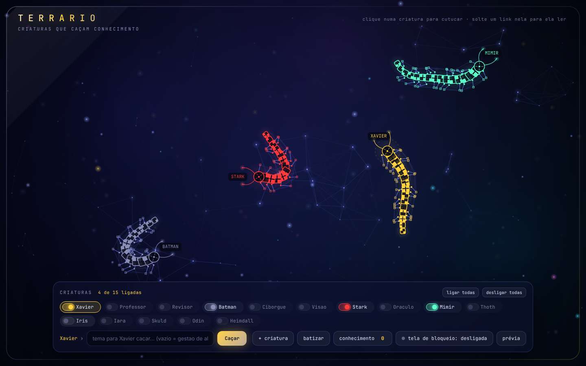
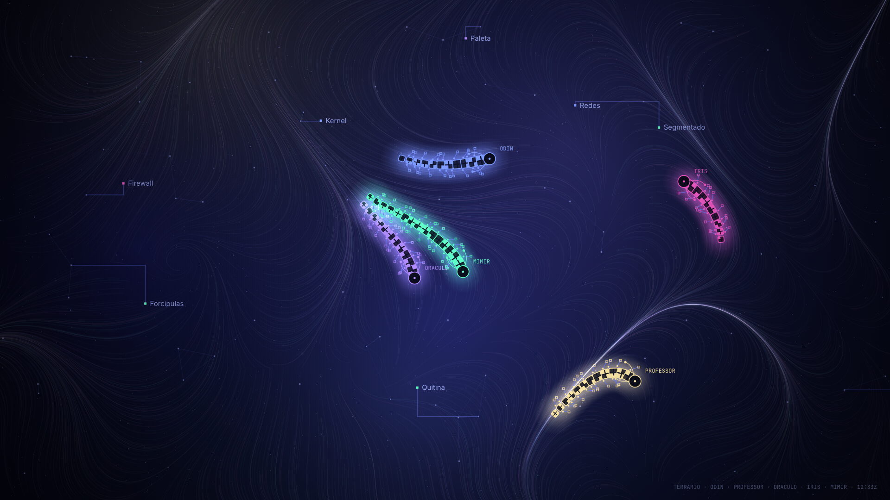

# Terrário

Um terrário de criaturas digitais. Cada criatura é uma centopeia de blocos com pernas de grafo, e cada uma tem um agente que caça um tema na web, lê as páginas na sua frente e grava o que aprendeu em **markdown**.

Inspiração: o vídeo "Crawlers" (criaturas que exploram a web). Aqui não há NFT nem blockchain: só a criatura, a leitura e o conhecimento.



## App de Windows

Baixe `Terrario.exe` (portátil, não instala nada) e abra. O terrário abre e fica um ícone na bandeja.

- **Criaturas**: uma para cada agente do Brain (Xavier, Professor, Revisor, Batman, Ciborgue, Visão, Stark, Oráculo, Mímir, Thoth, Íris, Iara, Skuld, Odin, Heimdall). Cada uma tem sua chave: ligue uma, várias ou todas (*ligar todas* / *desligar todas*). Só as ligadas andam no terrário.
- **Tela de bloqueio**: o botão *tela de bloqueio* liga e desliga. Ligada, cada vez que o Windows bloqueia (Win+L) o app pinta uma imagem nova e única com as criaturas ligadas e os termos que elas aprenderam, e ela aparece no próximo bloqueio. *Prévia* mostra uma na hora.
- **Bandeja**: abrir o terrário, ligar/desligar as criaturas e a tela de bloqueio, gerar uma tela agora, abrir as pastas, iniciar com o Windows, sair. Fechar a janela não fecha o app.
- Arquivos em `Documentos\Terrario`: `conhecimento\` (markdown) e `telas\` (as últimas 12 imagens).

A troca da tela de bloqueio usa a API do próprio Windows (via Windows PowerShell, sem administrador). Se a tela de bloqueio estiver em *Windows em destaque* (Spotlight) ou se uma política da empresa travar a personalização, o Windows pode ignorar a troca: o app avisa com a mensagem do erro.

Para gerar o `.exe`: `npm install` e `npm run dist` (sai em `dist/Terrario.exe`).

## Rodar no navegador

```bash
npm start            # abre em http://127.0.0.1:4747
```

Node 20 ou mais novo, sem dependências. Tudo fica no seu PC: o servidor só escuta em `127.0.0.1`.

| Variável | Para quê | Padrão |
|---|---|---|
| `TERRARIO_SAIDA` | pasta onde o markdown é gravado (ex.: a pasta de conhecimento do Brain) | `./conhecimento` |
| `ANTHROPIC_API_KEY` | se existir, o resumo é escrito pelo Claude; sem ela, o resumo é extrativo (primeiras frases de cada página) | vazio |
| `TERRARIO_MODELO` | modelo do resumo | `claude-sonnet-5-5` |
| `TERRARIO_WIKI` | Wikipedia usada para caçar temas | `https://pt.wikipedia.org` |
| `PORT` | porta | `4747` |

A chave nunca vai para arquivo nem para o repositório: só variável de ambiente.

## Usar

- **Caçar**: escolha a criatura, escreva um tema e clique em *Caçar*. Ela fareja, lê até 3 páginas rastejando palavra por palavra, solta os termos que achou e leva o resumo para a gaveta *conhecimento*.
- **Soltar um link**: arraste um link para perto de uma criatura (ou cole no campo). Ela lê só aquela página.
- **Cutucar**: clique numa criatura.
- **Batizar** (no próprio campo) e **+ criatura** (criaturas novas, fora do elenco). Até 20 ligadas ao mesmo tempo.
- Campo vazio + *Caçar*: a criatura caça o tema favorito dela (ex.: Batman caça segurança da informação).
- Abrir `public/index.html` direto, ou com `?demo`, roda uma demonstração sem servidor (nada é gravado).

## Privacidade

A criatura **não** lê a tela, arquivos nem o que você faz. Ela só lê o que recebe: um tema (busca na Wikipedia) ou um link que você soltou. Links para a rede interna (`localhost`, `10.x`, `192.168.x` etc.) são recusados.

## Testes

```bash
npm test             # agente, markdown e servidor (com uma Wikipedia falsa)
npm run test:ui      # abre no Chromium, liga/desliga criaturas, gera a prévia, faz uma caçada e grava capturas
npm run test:app     # abre o app (Electron) e gera uma tela de bloqueio; no Linux: xvfb-run -a npm run test:app
```

## Próximos passos

Veja [docs/conceito.md](docs/conceito.md). Celular fica para depois.


